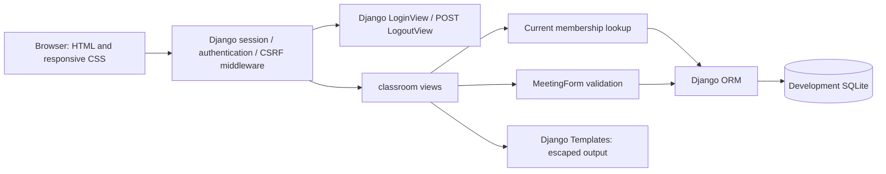
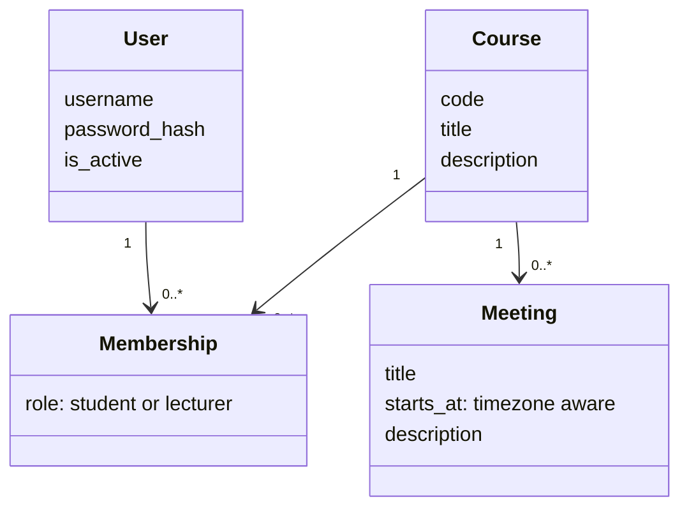
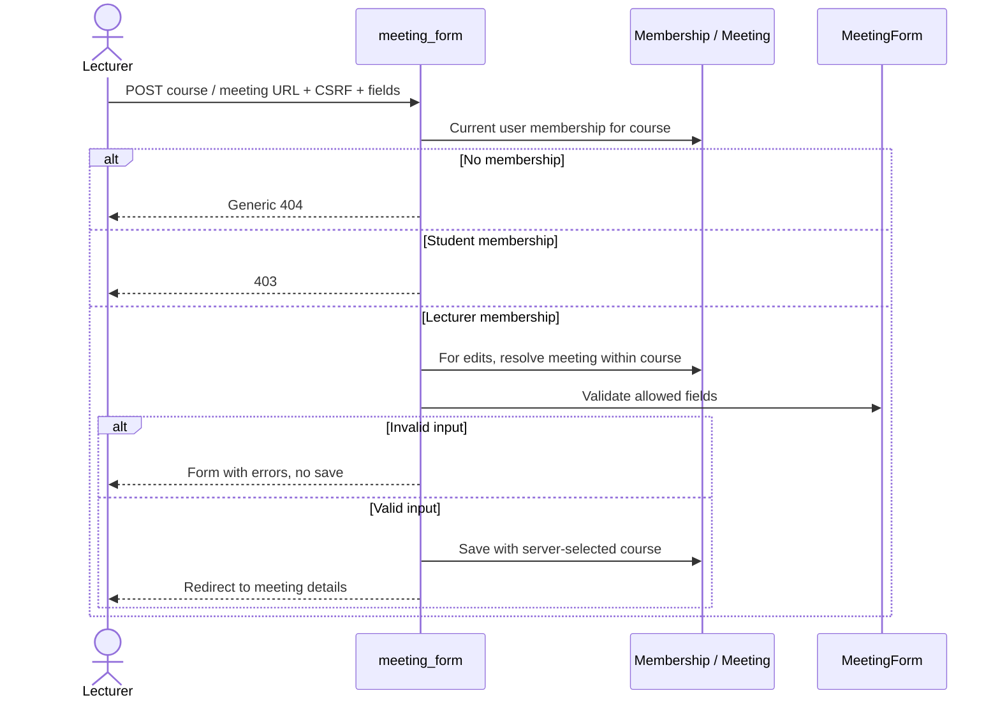

# Unit A Architecture

## Implemented boundary

Unit A implements the shared website foundation under D-23 through D-26.
Django 5.2.19 uses server-rendered Templates, CSS, sessions, forms, ORM and
migrations. The development database is SQLite. No client-side JavaScript is
needed for the current pages. No AI SDK, provider key or AI experiment module
is imported by the application. Attendance/comments and the other three
feature workflows are not implemented.

## Data model

User is Django's built-in user model. Membership has a database uniqueness
constraint on user/course and a check constraint restricting role values.
There is one role per user per course; a user can have different roles in
different courses. Course count, meeting count and membership count are not
capped by the demo fixtures. Meetings have no attendance-window, publication,
AI-job or lifecycle state in Unit A. Past meetings can be viewed and edited by
authorized lecturers; no future-only restriction is invented. Date/time
input and display use Asia/Jerusalem; internal values are timezone-aware.

## Authorization and writes

All classroom routes require an authenticated active user. On each request,
the server queries current membership, including writes from stale browser
pages. No URL parameter, posted role, posted user or hidden button grants
permission. Global staff/superuser flags do not bypass classroom membership.
There is no admin site or public account/course/membership-management UI.

| Operation | Student member | Lecturer member | Nonmember |
|---|---|---|---|
| List own courses | Own memberships | Own memberships | Empty list if no memberships |
| Read course/meeting | Allowed | Allowed | Generic 404 |
| Create/edit meeting | 403 | Allowed for that course | Generic 404 |

Meeting lookup includes both its ID and authorized parent course. A meeting
ID from another course cannot be substituted into an authorized course URL.
The form only binds title, start time and description. The view assigns the
course on the server, so posting a different course cannot move a meeting.
Login uses Django's safe-next handling; logout requires POST and CSRF.
Templates escape submitted text. These safeguards are verified separately in
[testing.md](testing.md), rather than inferred from hidden UI controls.

## Runtime and sample data

`.venv` is separate from `.ai-lab/venv`; website dependencies include no AI
libraries. `.local/` holds the development database, generated signing key,
random demo credentials and local server logs. These are ignored by Git.
Only password hashes go into the database. The credential file is local
plaintext for demo convenience, not a production credential-management design.

`seed_demo` creates six accounts, two courses, seven memberships and four
initial meetings. It retains existing passwords and refuses to take over
matching unrelated usernames. The README describes each account's access.
Courses/memberships are sample data; only meetings have a management UI.

Current UI copy is English as a reversible implementation choice. Responsive
CSS uses a single-column mobile layout, viewport metadata, wrapping content,
labels, focus styles and minimum main button sizes. Basic functional browser
checks were subsequently reported by the user (see testing.md). Viewport-specific
rendering and actual-phone usability remain unverified; the agent's browser
check was blocked by the origin approval gate.

## Planned replaceable AI boundary — not implemented

Future feature services should call a provider-independent text-generation
interface and a separate transcription interface. Inputs should carry source
text/audio references, task/language and required output structure. Results
should carry output, completion/error status, actual backend/model, usage and
latency metadata. An adapter may implement local inference or an approved
external provider without changing course permissions or feature views.

Configuration will select an adapter; persistence should not depend on a
provider's response format. Provider errors, quota exhaustion and partial
outputs must remain explicit. Test doubles must be labeled and must not be
presented as functioning AI. No adapter, fake AI feature, provider selection,
background worker or new AI trial is included in Unit A.

## Deployment limits

Loopback-only Django development server, DEBUG enabled, and development
SQLite are not production deployment. HTTPS, rate limiting, real identity,
data lifecycle and classroom write concurrency remain later work. No campus
IP gate, offline queue or synchronization mechanism is implemented.
