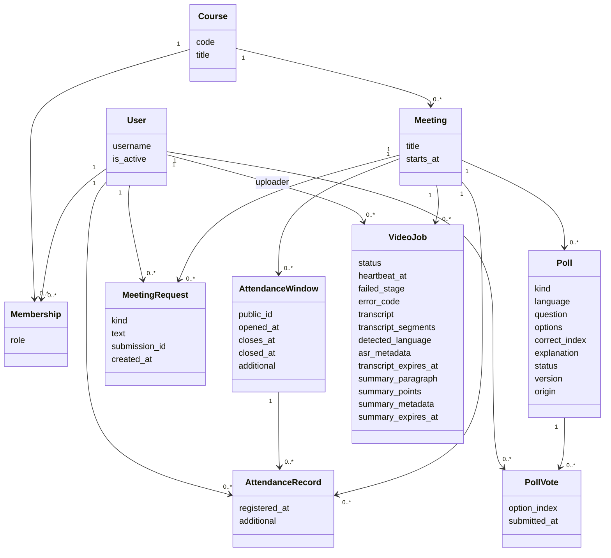
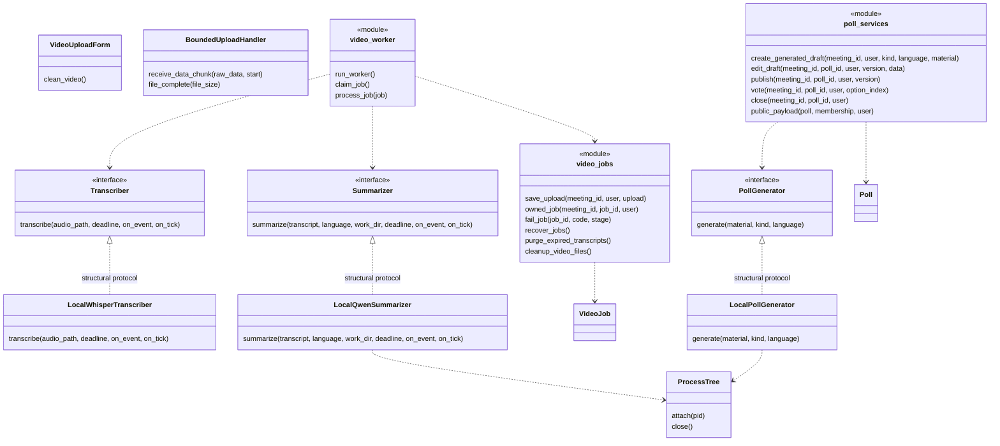
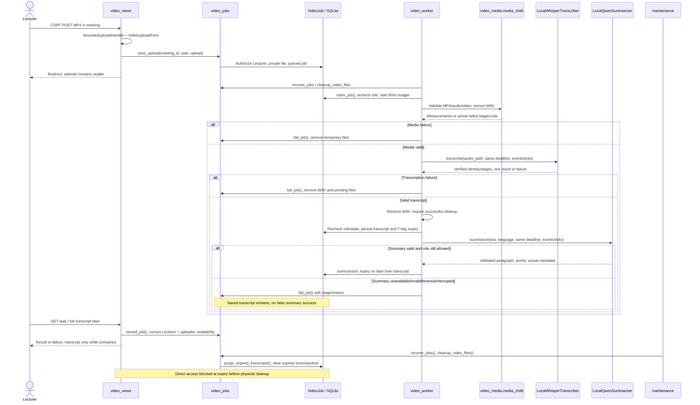
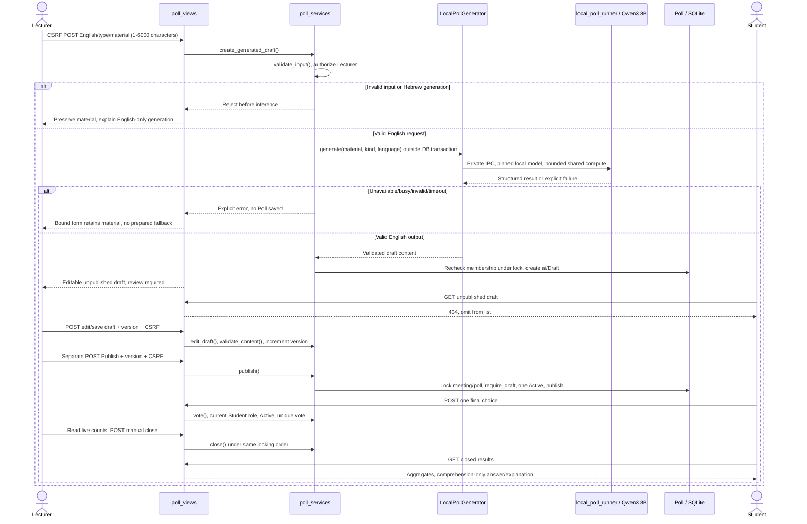
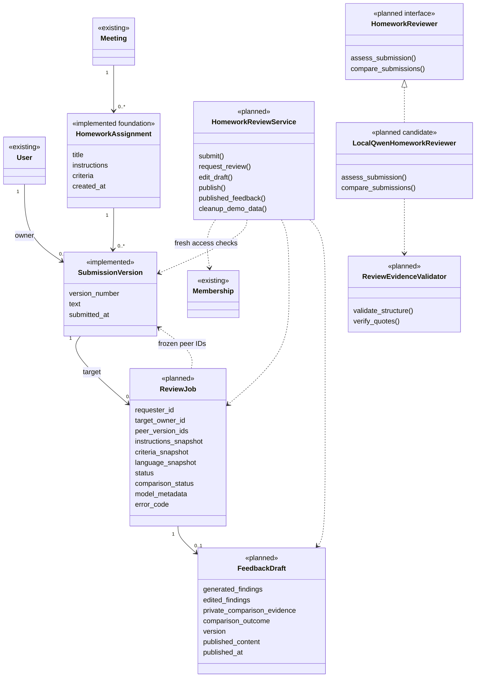
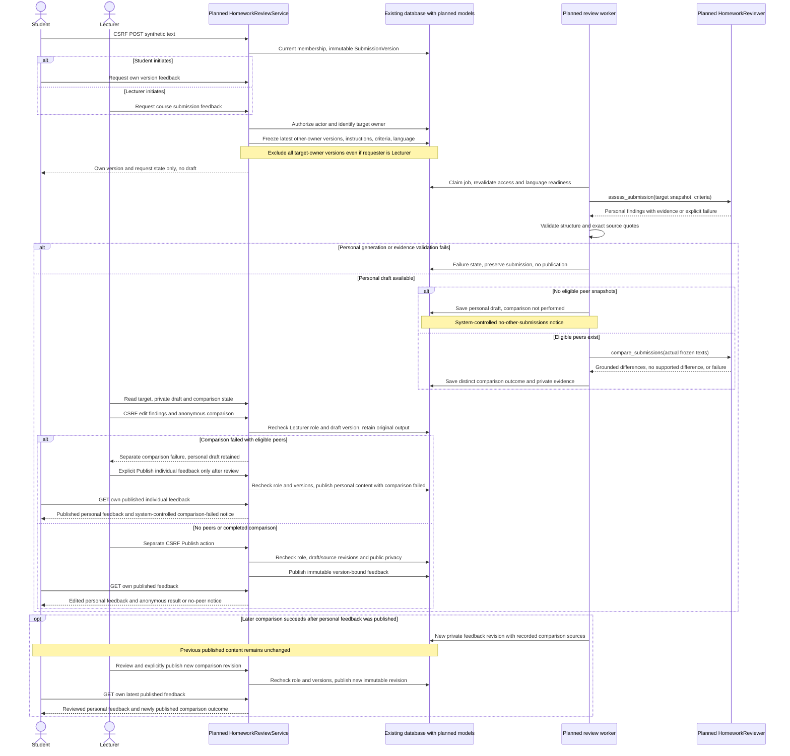

# Website Architecture

## Current implemented boundary

The website implements authentication/course roles, meetings, attendance/XLSX,
connected comments during/outside class (resolved D-17), poll lifecycle with local
English draft generation, and background MP4 extraction/transcription/summarization.
Homework assignment/submission and private version reading are implemented under
D-53; AI review/comparison remains planned. Current foundation and later planned
review components are separated below. See [requirements/use cases](SRS.md#5-main-use-cases),
[tools and observed evidence](local-ai-feasibility.md#current-tools-and-evidence-index),
and [component-to-test strategy](testing.md#current-component-to-test-strategy).

The QR, online-list/XLSX snapshot and speech-only video-summary interpretations
are implemented choices. The user reports sending all three clarification
questions to the lecturer; acceptance is **pending a reply**, not confirmed.
D-17 comments timing is resolved and is not part of that pending set.

## Current components

| Source component | Actual responsibility and boundary |
|---|---|
| `teachingtool/settings.py`, Django middleware/auth, `classroom/views.py` | Django 5.2.19 Templates/session/CSRF and meeting management; fresh course-membership authorization, SQLite development database. No public account/course administration. |
| `models.py` | Course/Membership/Meeting, AttendanceWindow/AttendanceRecord/MeetingRequest, Poll/PollVote and VideoJob persistence/constraints. |
| `attendance.py`, `participation_views.py`, `request_forms.py` | Rotating signed QR, POST registration/deduplication, XLSX snapshot, private comments/history and visible-page updates. |
| `poll_views.py`, `poll_forms.py`, `poll_services.py` | Generation form, draft edit/version checks, publication, final vote, close and disclosure-safe payload. No inference inside a database write transaction. |
| `poll_generation.py`, `local_poll_generator.py`, `poll_contract.py`, `local_poll_runner.py` | Replaceable PollGenerator contract, local Qwen3 8B English adapter, generated-output validation and isolated runtime. Fake providers are test-only; seed_demo_polls is a separate labeled local fixture command. |
| `video_uploads.py`, `video_forms.py`, `video_views.py`, `video_jobs.py` | Bound uploaded bytes, private persistence, uploader/current-role access, state payloads, failure/recovery and retention. |
| `video_worker.py`, `video_media.py`, `video_storage.py` | One persistent queue/worker; isolated CPU media validation and WAV extraction, locks, deadline/heartbeat and private file handling. |
| `video_engines.py`, `local_transcriber.py`, `local_asr_runner.py`, `asr_checkpoint.py` | Transcriber contract/factory, pinned local large-v3-turbo, CUDA float16, offline checkpoint validation, supervised events and validated transcript results. |
| `local_summarizer.py`, `local_summary_runner.py`, `summary_contract.py` | Summarizer implementation, pinned Qwen3 8B/structured paragraph plus 3-5 points, language/identity checks; no semantic-accuracy guarantee. |
| `process_tree.py`, `process_lock.py` | Owned Windows process-tree lifetime and exclusive local compute access. Poll generation and video AI do not overlap on the shared compute lock. |
| `transcript_display.py`, Templates, `static/js` | Word-preserving paragraphs/RTL-LTR isolation, escaped server-rendered results, visible-page polling and form interactions. |

`get_transcriber()`, `get_summarizer()` and `get_poll_generator()` return the local
implementations. Disabled classes still exist in code but are not current factory
results. No normal runtime fake provider, external inference or paid fallback is
selected. Models/runtimes/private data remain outside Git.

## Class and interface diagrams

These diagrams name real classes/interfaces and selected real operations. Boxes
marked **module** describe function-based modules, not invented Python classes.
Fields/operations are selected for responsibilities, not a complete ORM listing.
The strategy table uses the same names and links to executable test methods.

Membership is unique per user/course, so roles can differ across courses. Attendance
is unique per meeting/student; additional windows preserve first registration.
Poll votes are unique per poll/student and a conditional database constraint allows
only one Active poll per meeting. VideoJob stores actual model provenance separately
from requested identity and preserves historical completed jobs.

Python Protocols use structural conformance; adapters do not inherit them explicitly.
Function argument lists above omit optional/test-only parameters; the code is the
source of exact signatures. ASR subprocess supervision is in LocalWhisperTranscriber;
ProcessTree ownership is used for the Qwen subprocess/service descendants.

## Video sequence

A WAV cleanup failure also routes to fail_job before saving a transcript or
starting summary; the diagram abbreviates this guard. Actual states are queued,
validating, extracting, loading_asr, transcribing, loading_sum, summarizing and
terminal extracted/transcribed/summarized/failed (plus uploading during persistence).
The persisted start governs a single 600-second processing deadline; queue wait
is separate. Heartbeats/recovery and the worker lock prevent indefinitely active
jobs or concurrent workers. Owner and fresh Lecturer role are checked on direct
URLs and before saving outputs. WAV/IPC files are removed on normal/failure cleanup.

Sources are private UUID paths, capped at 240 seconds/200,000,000 bytes, and expire
within 24 hours while maintenance operates. Transcript access ends seven days after
creation; summaries never outlive it. Maintenance clears content, not the job's
history. Physical deletion cannot occur while the computer/maintenance is stopped.
No public MEDIA_URL, original-file download or raw-audio endpoint exists.

## Poll generation and publication sequence

Validation occurs at adapter/service boundaries; a failed provider call does not
continue through the success messages shown above. The runner's compute lock
serializes against video AI; busy is an explicit error. Generation has a 120-second
startup/generation limit and no automatic retry. Publication checks the current
draft version; voting/closing serialize under short SQLite IMMEDIATE transactions.
Active Student HTML/JSON contain no answer/explanation or aggregates. Opinion polls
never have correctness fields. The review-required notice is Lecturer/Draft-only.

## Shared participation and authorization

All feature routes require current course membership, not just hidden controls.
Cross-course or mismatched parent IDs yield generic 404; wrong-role access gives
403. Student histories filter by owner; Lecturer feeds/exports recheck role. Staff
flags do not bypass course membership. Login preserves a safe next URL, logout
requires CSRF POST, and templates escape text. MeetingForm binds allowed fields
and the server assigns the course. Past meetings remain usable.

Attendance opens a five-minute initial window, rotates signed QR every 30 seconds
and accepts a code for 45 seconds bounded by closure. Later windows last two
minutes. GET/login continuation revalidates; only CSRF POST registers, preserving
one meeting/student record. A valid code can be forwarded: physical presence is
not proven. XLSX is a snapshot, without back-sync or manual corrections.

Comments accept 1-1000 trimmed characters and retain private history; a visible
Lecturer page polls every five seconds. D-17 is resolved as during/outside class,
including past meetings and later Lecturer login, using the same connected path.
No disconnected queue/local persistence/synchronization is required.

## Planned UC-05 components

**Mixed status - D-46 through D-53.** HomeworkAssignment and SubmissionVersion
are now implemented. ReviewJob, FeedbackDraft, HomeworkReviewService, reviewer/
validator and background review worker remain planned additions. Existing
Meeting/User/Membership, Django session/CSRF/Templates, short SQLite transactions
and the local compute lock are integration points. Do not extend VideoJob or
silently route homework through the video worker. A separate review worker is
planned; timeout, workload and queue controls need measured bounds. Existing Qwen3
is a candidate adapter, not an accepted homework engine in either language.

| Component / status | Responsibility / integration |
|---|---|
| HomeworkAssignment - implemented foundation | Meeting/creator, title, instructions, ordered criterion text and creation timestamp. Stable criterion IDs, rubric revision and feedback-language configuration are later review-stage extensions. |
| SubmissionVersion - implemented | Exact submitted text, assignment/Student/version and timestamp; next number serialized under a short transaction, unique per owner/assignment/version. Submitted status is a display property. No update/delete route. |
| ReviewJob | Requester separately from target owner, target/peer version IDs, copied instructions/criteria/language, processing/comparison states, actual engine metadata and errors. Freeze the latest version per other owner at request creation, even for Lecturer requests. |
| FeedbackDraft | Original model findings separately from Lecturer edits, target and private comparison evidence, draft edit version, comparison outcome, published content and timestamp. Published content is immutable and version-bound. |
| HomeworkReviewService | Current membership/ownership, submission/version creation, atomic source selection, request, optimistic draft editing, separate publication and safe Student projection. |
| HomeworkReviewer protocol / LocalQwenHomeworkReviewer | Separate target assessment and actual-source comparison. Local Qwen implementation remains conditional on language/quality acceptance; no runtime fake or canned fallback. |
| ReviewEvidenceValidator | Shape/criterion/source references and exact quote presence against the referenced version; never certify entailment or technical correctness from a substring match. |
| Dedicated review worker | Claim queued requests, enforce planned control bounds and shared compute lock, evaluate target first and peers second, save explicit partial/failure states without publishing. |

Choose sources by **target owner**, not actor: exclude every version of that owner,
then latest submitted version per other owner in the same assignment at the saved
request instant. Persist IDs and content/provenance needed to reproduce the exact
inputs. Later submissions, changed criteria or output-language changes do not
silently mutate an existing request. Publication checks the draft/source revision
and never presents historical feedback as a review of new text.

### Planned homework class diagram

Classes marked planned remain additions, not executable interfaces. The two
submission foundation models are marked implemented; other existing infrastructure
is marked existing. Method names here are design proposals; unlike
the implemented diagrams above, they do not assert that Python methods exist.

### Planned homework submission to publication sequence

The submission/create/read subset is implemented under D-53; all review/request/
comparison/publication arrows below remain a proposed future path, not execution evidence. The English/Hebrew
language gate is closed until real-output review accepts that language for this
workflow. The diagram assumes that gate has passed; earlier failed probes do not
open it. Failures cannot become public feedback by following the success branch.

Do not collapse the comparison outcomes: empty peer set means not performed;
nonempty set plus generation/validation failure means failed; a completed comparison
may contain grounded differences or a grounded no-supported-difference result.
D-52 permits individual-only publication of a successful personal draft after
comparison failure, but only after explicit Lecturer review/choice. If personal
generation fails, no draft exists for publication. The failed-comparison notice
is fixed by [UC-05](SRS.md#uc-05---submit-homework-review-a-draft-and-publish-feedback).
A later comparison remains private until separate Lecturer review/publication;
it is a new feedback revision, not a silent mutation of published content.
Student-facing output never includes internal peer IDs, stable identifying labels,
full peer works or private evidence. No grades, ranking, plagiarism judgment or
code execution. Similarity is not a finding of copying.

Retain synthetic versions/feedback until the demo and submission checking finish,
then provide an explicit authorized cleanup operation. Scope, confirmation and
referential cleanup must be designed/tested before execution; no timed video
retention policy is inherited and no real student-data policy is approved.

Planned responsibilities and risks map to the
[UC-05 acceptance strategy](testing.md#planned-uc-05-acceptance-strategy).
The source workflow is [UC-05](SRS.md#uc-05---submit-homework-review-a-draft-and-publish-feedback).

## Historical milestones and remaining boundaries

Unit A was foundation-only; Unit B added participation; initial Unit C used a
disabled generator and local demo drafts; Unit D initially stopped at extraction;
Unit E added ASR. D-41/D-42/D-43/D-44 supersede those old disabled boundaries for
new uploads/English drafts. Historical records remain in testing and experiment
reports and must not be read as current factories or full acceptance.

The website is loopback development with DEBUG/SQLite, not a production/classroom
deployment. Phone access, classroom load, HTTPS/hardening and the ten-minute demo
remain unverified. Homework comparison/review has failed quality expectations in
local feasibility work; only the assignment/submission foundation is implemented. The review/comparison
classes and arrows above remain planned, with model quality unaccepted. Optional campus-network checks remain deferred and nonblocking.

## Implemented UC-05 submission foundation

`homework_forms.py` validates nonblank input and an ordered line-per-criterion
list; submission text uses strip=False. `homework_views.py` reuses the existing
scoped/context guard. `homework_services.py` provides actual create_assignment,
submit_version, assignment_for and submission_for functions; it is not the
planned HomeworkReviewService class. Writes recheck role under transaction and
assign meeting/owner server-side. SQLite IMMEDIATE plus the unique version
constraint serializes concurrent submissions. SubmissionVersion.save rejects
existing-row edits; direct ORM bulk/SQL administration is outside that application
guard. Neither form nor service invokes a model.

New URL names: homework-list, homework-create, homework-detail and
homework-submission. The meeting page links to them. Current-role/parent checks
cover course, meeting and assignment; the version queryset filters Student owners.
Private pages use the shared never-cache guard. Templates escape text, preserve
line breaks and use dir=auto. Four new Templates and a small CSS rule reuse the
existing layout; actual-phone rendering remains unverified. Database migration
0007_homework_submissions adds only the two foundation models. No feedback model,
review request action, worker task, language setting or publication route exists.
