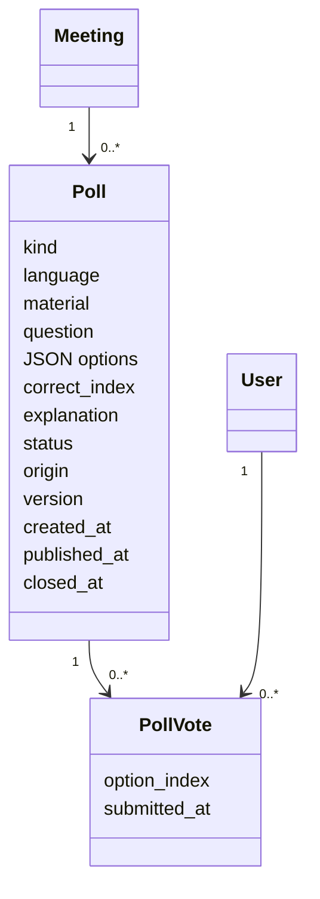
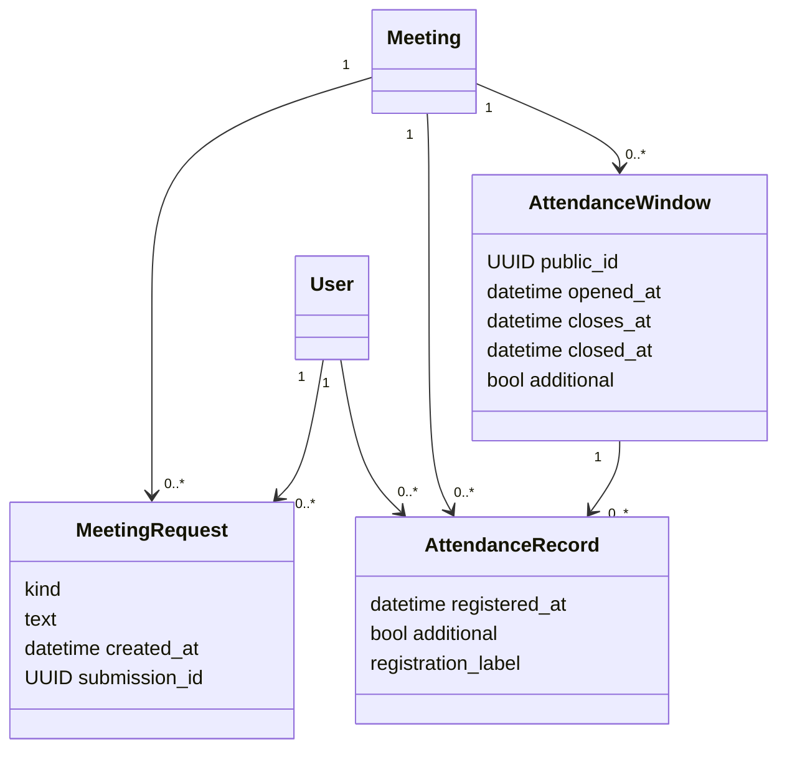
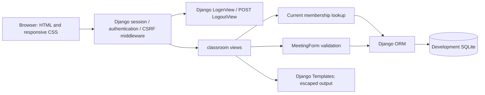
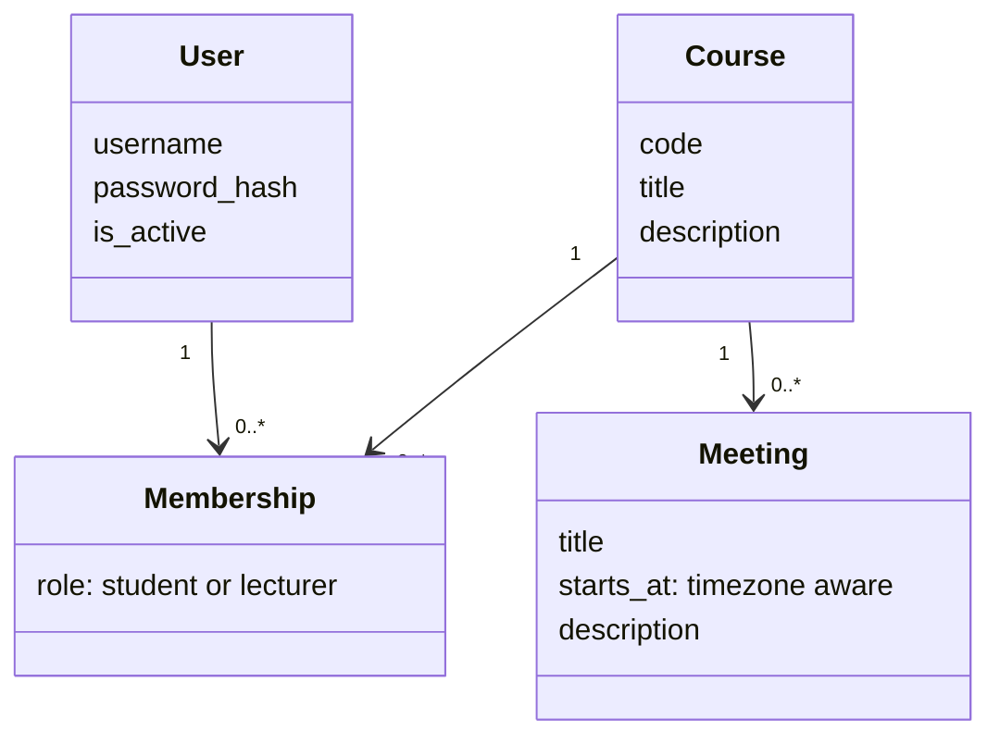
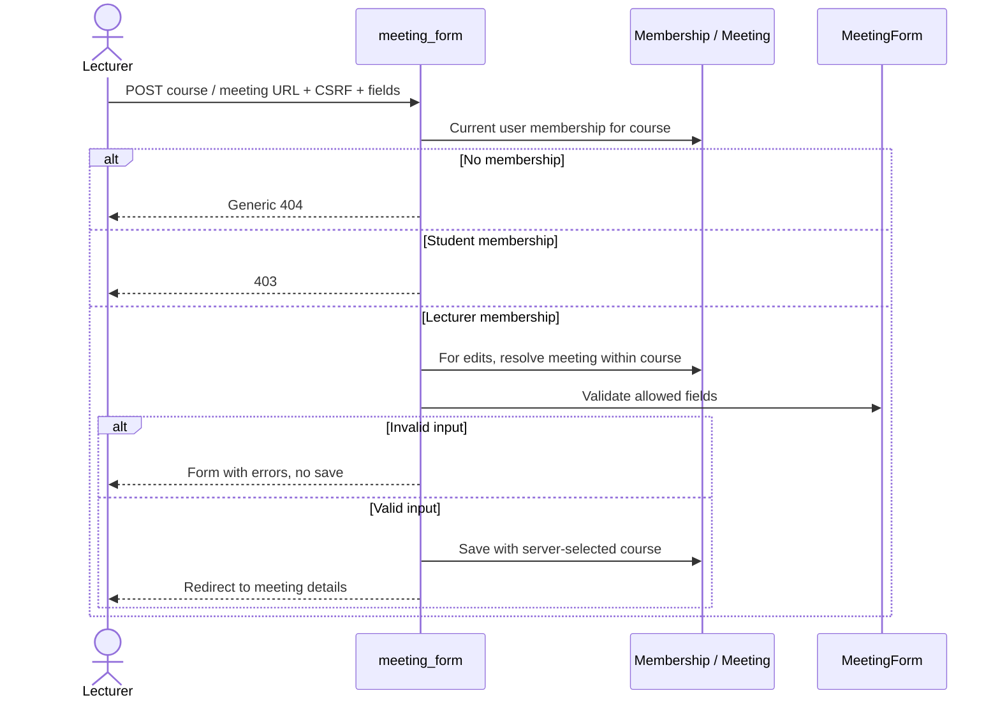

# Website Architecture — Units A, B and C

## Unit C poll lifecycle

Polls reuse the course-membership guard, CSRF middleware, responsive Templates
and SQLite IMMEDIATE short transactions. No package or AI SDK was added.
`poll_views.py` handles role-scoped HTML/JSON; `poll_forms.py` validates generation
input, draft edits, optimistic versions and one selected option. `poll_services.py`
owns transitions and the disclosure whitelist. No external call occurs in Unit C.



The four options are stored as validated JSON, with one vote's index constrained
to 0–3. The database restricts type/language/origin, answer metadata by poll type,
and timestamp/status consistency. A conditional unique constraint permits only
one Active poll per meeting; a unique poll/student constraint makes votes final.
Opinion polls must have null correct_index and empty explanation. No grades,
identity-bearing result list, reopen, delete or post-publication edit is exposed.

Every write locks the meeting first and then the poll, under a short atomic
transaction. Publication checks the draft version, full content and active-poll
absence; editing increments the version, so a stale page cannot publish unseen
edits. Voting checks fresh Student membership and Active status after the lock;
closing acquires the same locks. Either a racing vote commits before close or
is rejected after close. There is no provider wait inside these locks.

```mermaid
sequenceDiagram
    participant L as Lecturer
    participant D as Django
    participant DB as SQLite
    participant S as Student
    L->>D: POST publish reviewed draft + version + CSRF
    D->>DB: Lock meeting/poll; validate Draft and one Active; publish
    S->>D: GET poll (no answer key or aggregates)
    S->>D: POST one option + CSRF
    D->>DB: Lock meeting/poll; check Active and unique vote; save
    L->>D: GET live state while visible
    D-->>L: Counts and percentages, no response identities
    L->>D: POST manual close + CSRF
    D->>DB: Lock same records; mark Closed
    S->>D: Reload closed poll
    D-->>S: Aggregates; comprehension-only answer and explanation
```

`public_payload` constructs an explicit whitelist. Students cannot access drafts;
while Active they receive no counts, material, answer index, answer designation
or explanation, including JSON/hidden HTML. Closed comprehension polls reveal
the key/explanation; opinion polls never serialize these fields. Percentages use
accepted votes rounded to two decimals, zero-safe, with no respondent identities.
Lecturer read polling follows the Unit B visible-page 5-second pattern. A competing
status change asks for reload instead of preserving misleading action controls.

`poll_generation.py` defines the replaceable `PollGenerator` contract and the
only normal factory result, `DisabledPollGenerator`. It raises unavailable,
without HTTP, keys or a fabricated draft. Invalid eventual output is rejected
before persistence and membership is rechecked after generation. Fake generators
exist in automated tests only and cannot be selected through runtime settings.
Real generation/provider choice, language quality and external data approval are
unverified future work; no live AI request is permitted by this implementation.

`seed_demo_polls` is a separate local fixture route, explicitly approved under
D-33. It creates two Draft examples marked Demo data — not generated by AI,
with he/en variants and stable demo keys. It preserves edited/published/closed
examples on repeat runs; --new-set explicitly creates a new pair. No provider,
publication or voting action occurs in the command.

## Unit B participation design

`participation_views.py` enforces course-scoped attendance and request access;
`attendance.py` isolates signed QR rules and write transactions. Dependencies
added in the website `.venv`: qrcode 8.2 (SVG, no Pillow), openpyxl 3.1.5,
et_xmlfile 2.0.0 and colorama 0.4.6. The website imports no AI provider.

```mermaid
sequenceDiagram
    participant L as Lecturer
    participant S as Student browser
    participant D as Django
    participant DB as SQLite
    L->>D: CSRF POST open window
    D->>DB: Create window atomically
    L->>D: GET state while visible
    D-->>L: Signed rotating QR and roster
    S->>D: GET scanned URL
    D-->>S: Login if needed, preserving safe next URL
    S->>D: Login and GET continuation
    D-->>S: Revalidate membership/code; CSRF form
    S->>D: POST form automatically, or manual fallback
    D->>DB: Serialize; revalidate time/access; unique registration
    D-->>S: Confirmed status or rescan error
```

AttendanceWindow stores a public UUID, meeting, opening/closing timestamps,
explicit closure and additional-window flag. Only one unclosed window per
meeting is allowed; opening after expiry closes that row before creating the
next. AttendanceRecord stores student, meeting, original window/time and
additional-window flag, unique per student/meeting. MeetingRequest stores
student, meeting, type, text, timestamp and per-form UUID for duplicate-POST
deduplication. Recorded history is protected from accidental FK deletion;
there is no deletion UI or approved retention period.



Signed QR payloads contain window UUID, meeting ID and a 30-second bucket,
using a dedicated signing salt and the ignored local Django secret. No student
identity is embedded. Codes stay stable within a bucket and expire at its
start +45 seconds or window closure, whichever occurs first. Closed/replaced
windows never become valid again. GET does not persist attendance or QR rows.
After acquiring the write lock, validation uses current server time; client
countdowns are informational. Valid signed links can still be forwarded.

SQLite uses BEGIN IMMEDIATE with a 10-second busy timeout in short explicit
atomic sections, not request-wide transactions. Writes serialize before reads,
avoiding read-to-write upgrade races. Database uniqueness is the final duplicate
safeguard. select_for_update expresses a possible future backend lock but is
a no-op on SQLite. Export reads a consistent short snapshot, then builds XLSX
outside the transaction; string cells prevent user-input formula execution.
Database-busy errors return 503 without a save confirmation or automatic POST
retry. Two concurrent requests are tested, not full classroom load.

Every Unit B endpoint authenticates and freshly resolves course membership.
Only lecturers access roster/state/export/window actions; scan/request writes
require Student role. Parent mismatch/nonmembership gives generic 404; wrong
role gives 403. Sensitive responses disable caching. Student history is filtered
server-side and lecturer JSON feeds recheck roles. HTML is escaped; dynamic
text uses textContent. No browser persistence or offline send queue exists.

Lecturer requests poll every 5 seconds while visible; hidden pages cancel reads
and resume on visibility. Attendance polls every 5 seconds or sooner at a QR
boundary, with a local countdown. Read errors warn that prior data may be
outdated. Composition, CSRF POST submission and confirmed database storage
remain distinct, preserving the unresolved D-17 offline boundary.

Official references consulted:
[Django SQLite transactions](https://docs.djangoproject.com/en/5.2/ref/databases/#transactions-behavior),
[Django atomic transactions](https://docs.djangoproject.com/en/5.2/topics/db/transactions/),
[qrcode](https://pypi.org/project/qrcode/),
[openpyxl](https://openpyxl.readthedocs.io/en/stable/).

## Implemented boundary

Unit A implements the shared website foundation under D-23 through D-26.
Django 5.2.19 uses server-rendered Templates, CSS, sessions, forms, ORM and
migrations. The development database is SQLite. Small Unit B scripts handle scan POST submission and visible-page polling. No AI SDK, provider key or AI experiment module
is imported by the application. Attendance and connected comments are implemented under D-27 through D-30; the poll lifecycle is also implemented under Unit C; real poll generation and the video/homework website workflows remain unimplemented.



## Data model



User is Django's built-in user model. Membership has a database uniqueness
constraint on user/course and a check constraint restricting role values.
There is one role per user per course; a user can have different roles in
different courses. Course count, meeting count and membership count are not
capped by the demo fixtures. Meetings have no attendance-window, publication,
AI-job or lifecycle state in Unit A. Past meetings can be viewed and edited by
authorized lecturers; no future-only restriction is invented. Date/time
input and display use Asia/Jerusalem; internal values are timezone-aware.

## Authorization and writes

All classroom routes require an authenticated active user. On each request,
the server queries current membership, including writes from stale browser
pages. No URL parameter, posted role, posted user or hidden button grants
permission. Global staff/superuser flags do not bypass classroom membership.
There is no admin site or public account/course/membership-management UI.

| Operation | Student member | Lecturer member | Nonmember |
|---|---|---|---|
| List own courses | Own memberships | Own memberships | Empty list if no memberships |
| Read course/meeting | Allowed | Allowed | Generic 404 |
| Create/edit meeting | 403 | Allowed for that course | Generic 404 |

Meeting lookup includes both its ID and authorized parent course. A meeting
ID from another course cannot be substituted into an authorized course URL.
The form only binds title, start time and description. The view assigns the
course on the server, so posting a different course cannot move a meeting.
Login uses Django's safe-next handling; logout requires POST and CSRF.
Templates escape submitted text. These safeguards are verified separately in
[testing.md](testing.md), rather than inferred from hidden UI controls.



## Runtime and sample data

`.venv` is separate from `.ai-lab/venv`; website dependencies include no AI
libraries. `.local/` holds the development database, generated signing key,
random demo credentials and local server logs. These are ignored by Git.
Only password hashes go into the database. The credential file is local
plaintext for demo convenience, not a production credential-management design.

`seed_demo` creates six accounts, two courses, seven memberships and four
initial meetings. It retains existing passwords and refuses to take over
matching unrelated usernames. The README describes each account's access.
Courses/memberships are sample data; only meetings have a management UI.

Current UI copy is English as a reversible implementation choice. Responsive
CSS uses a single-column mobile layout, viewport metadata, wrapping content,
labels, focus styles and minimum main button sizes. Basic functional browser
checks were subsequently reported by the user (see testing.md). Viewport-specific
rendering and actual-phone usability remain unverified; the agent's browser
check was blocked by the origin approval gate.

## Broader AI boundary — planned; disabled poll contract implemented

Future feature services should call a provider-independent text-generation
interface and a separate transcription interface. Inputs should carry source
text/audio references, task/language and required output structure. Results
should carry output, completion/error status, actual backend/model, usage and
latency metadata. An adapter may implement local inference or an approved
external provider without changing course permissions or feature views.

Configuration will select an adapter; persistence should not depend on a
provider's response format. Provider errors, quota exhaustion and partial
outputs must remain explicit. Test doubles must be labeled and must not be
presented as functioning AI. No adapter, fake AI feature, provider selection,
background worker or new AI trial is included in Unit A.

## Deployment limits

Loopback-only Django development server, DEBUG enabled, and development
SQLite are not production deployment. HTTPS, rate limiting, real identity,
data lifecycle and classroom write concurrency remain later work. No campus
IP gate, offline queue or synchronization mechanism is implemented.
