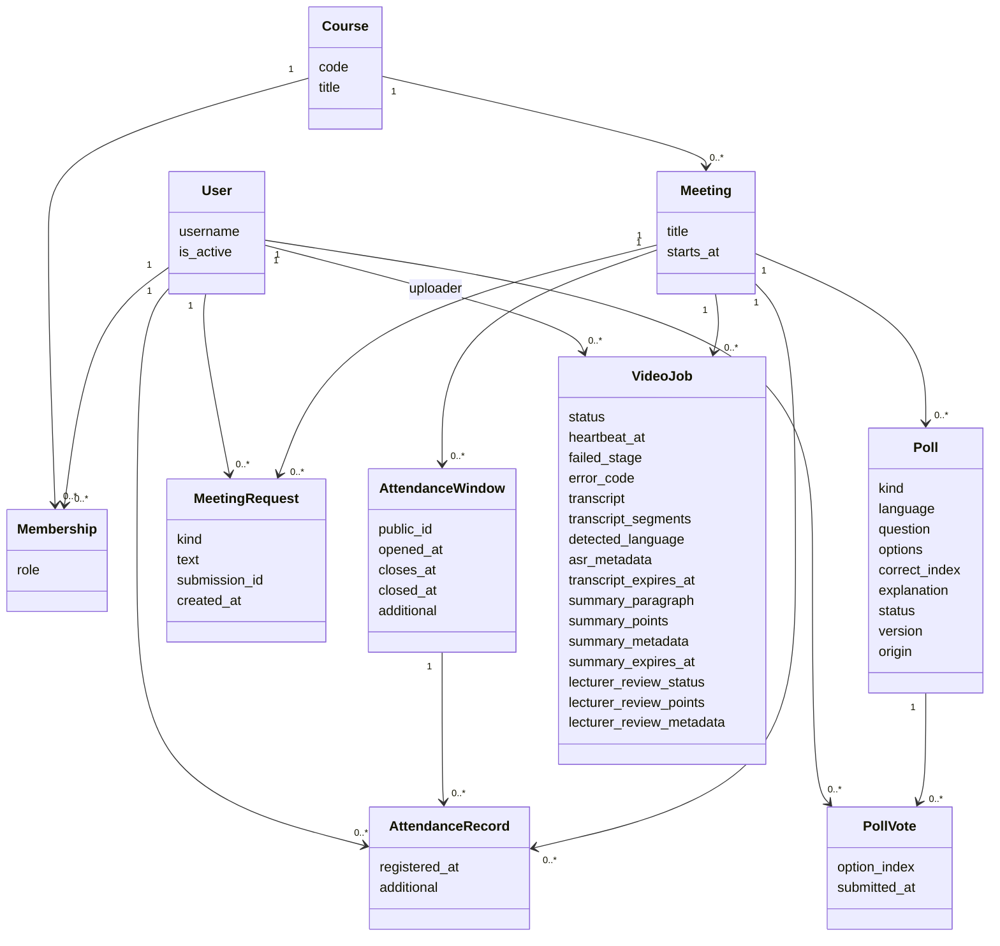
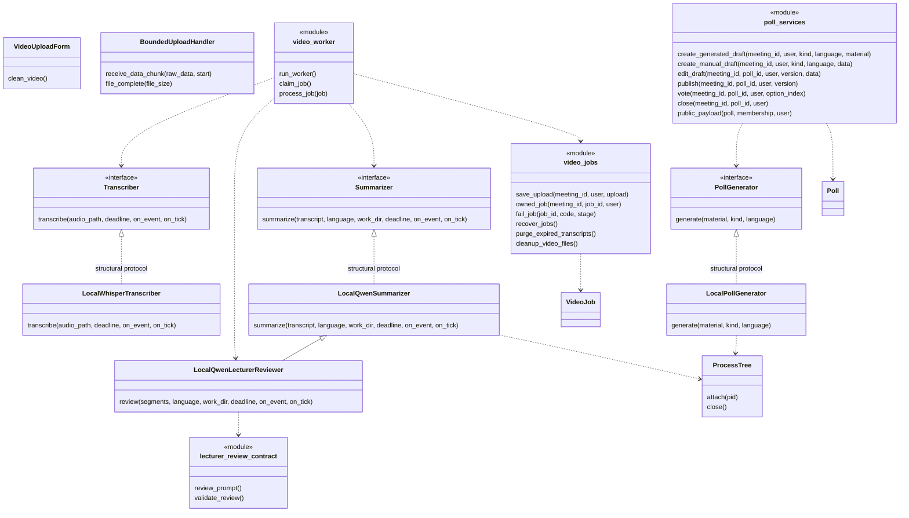
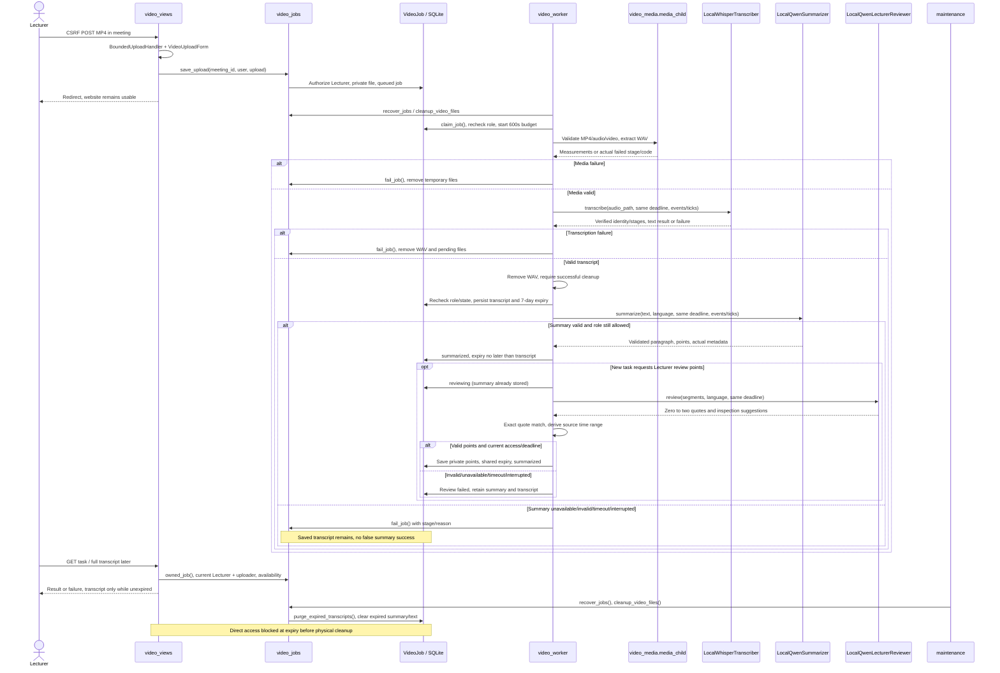
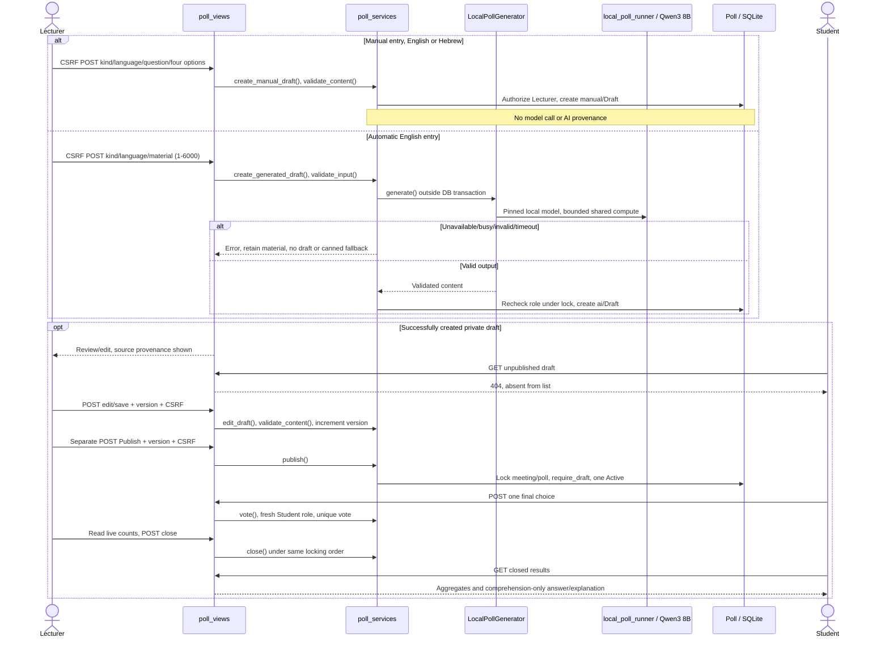
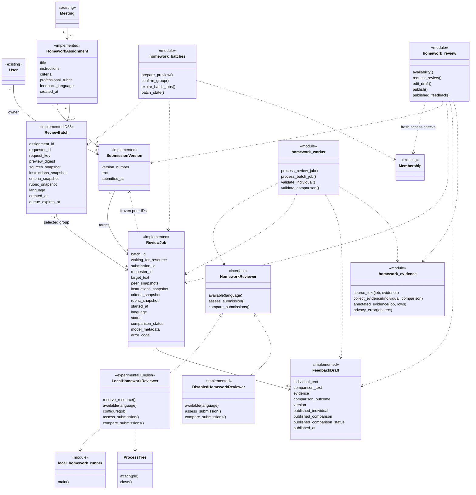
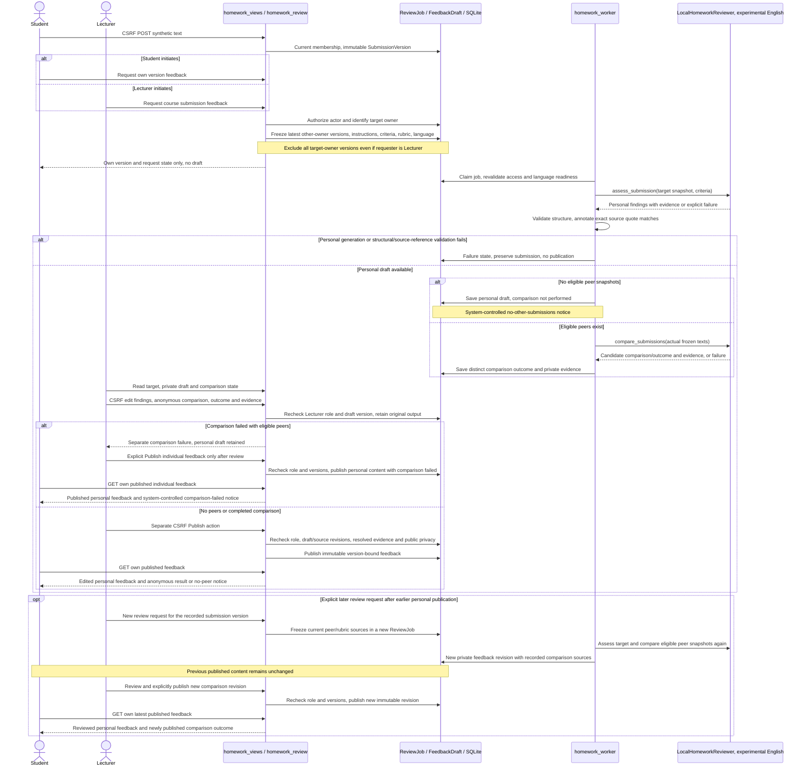
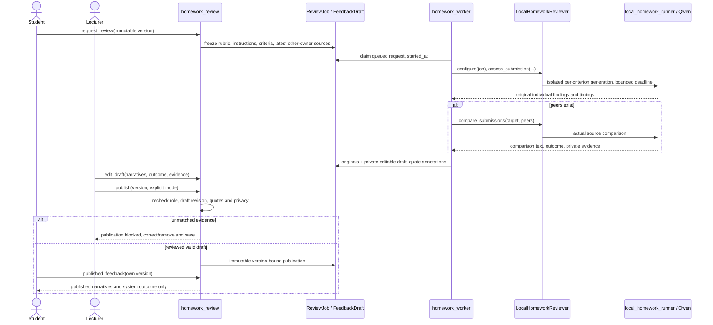

# Website Architecture

## Current implemented boundary

The website implements authentication/course roles, meetings, attendance/XLSX,
connected comments during/outside class (resolved D-17), poll lifecycle with local
English draft generation, and background MP4 extraction/transcription/summarization.
Homework assignment/submission and private version reading are implemented under
D-53; D-56 now connects experimental local English AI review/comparison with a recorded professional rubric, private editable evidence and separate publication. Hebrew generation and robust model quality remain open. See [requirements/use cases](SRS.md#5-main-use-cases),
[tools and observed evidence](local-ai-feasibility.md#current-tools-and-evidence-index),
and [component-to-test strategy](testing.md#current-component-to-test-strategy).

The lecturer response, reported by the user, refers to requirements 1-5 in the
lecture and gives us freedom over design/implementation. The email wait is closed.
The project chooses rotating QR (valid codes can still be forwarded), an online
attendance list plus an XLSX snapshot readable without a connection, and summaries
of recorded speech excluding unspoken visuals. These choices are ours, not
technical prescriptions by the lecturer. Review the relevant lecture section; no
claim of independent lecture review is made here.
D-17 comments timing is resolved; none of those three email questions remains pending.

## Selected demonstration-group coordinator (D-58)

`ReviewBatch` records one Lecturer confirmation, immutable selected sources/context,
an idempotency key and queue expiry. `homework_batches.prepare_preview` signs source/
context hashes; `confirm_group` rechecks them under the meeting write lock and
atomically creates the batch plus its existing `ReviewJob` children. Group/status
routes are lecturer-only. `homework_groups.js` makes visible-page status reads only.

For group jobs, `LocalHomeworkReviewer.reserve_resource` holds the existing shared
decoder lock in the parent across both stages. Owned homework runners receive
`--resource-reserved` instead of reacquiring the same lock. Busy waiting performs
no inference and holds no HTTP/DB writer transaction. Queue expiry is confirmation
+15 minutes; processing starts after reservation and keeps the 180-second budget.
Restart fails interrupted work without replay and retains pending deadlines.
Worker/status/display guards expire overdue work; late results cannot create drafts.
The existing single-review, poll and video compute paths remain unchanged.

## Current components

| Source component | Actual responsibility and boundary |
|---|---|
| `teachingtool/settings.py`, Django middleware/auth, `classroom/views.py` | Django 5.2.19 Templates/session/CSRF and meeting management; fresh course-membership authorization, SQLite development database. No public account/course administration. |
| `models.py` | Course/Membership/Meeting, AttendanceWindow/AttendanceRecord/MeetingRequest, Poll/PollVote, VideoJob, HomeworkAssignment/SubmissionVersion and ReviewBatch/ReviewJob/FeedbackDraft persistence/constraints. |
| `attendance.py`, `participation_views.py`, `request_forms.py` | Rotating signed QR, POST registration/deduplication, XLSX snapshot, private comments/history, Lecturer-only literal-text XLSX export and visible-page updates. |
| `poll_views.py`, `poll_forms.py`, `poll_services.py` | Lecturer-authored manual drafts plus the AI generation form, draft edit/version checks, publication, final vote, close and disclosure-safe payload. No inference inside a database write transaction. |
| `poll_generation.py`, `local_poll_generator.py`, `poll_contract.py`, `local_poll_runner.py` | Replaceable PollGenerator contract, local Qwen3 8B English adapter, generated-output validation and isolated runtime. Fake providers are test-only; seed_demo_polls is a separate labeled local fixture command. |
| `video_uploads.py`, `video_forms.py`, `video_views.py`, `video_jobs.py` | Bound uploaded bytes, private persistence, uploader/current-role access, state payloads, failure/recovery and retention. |
| `video_worker.py`, `video_media.py`, `video_storage.py` | One persistent queue/worker; isolated CPU media validation and WAV extraction, locks, deadline/heartbeat and private file handling. |
| `video_engines.py`, `local_transcriber.py`, `local_asr_runner.py`, `asr_checkpoint.py` | Transcriber contract/factory, pinned local large-v3-turbo, CUDA float16, offline checkpoint validation, supervised events and validated transcript results. |
| `local_summarizer.py`, `local_summary_runner.py`, `summary_contract.py`, `lecturer_review_contract.py` | Summarizer implementation, pinned Qwen3 8B/structured paragraph plus 3-5 points, language/identity checks plus optional quote-bound Lecturer inspection points; no semantic-accuracy guarantee. |
| `homework_views.py`, `homework_review.py`, `homework_worker.py`, `homework_evidence.py` | Version-bound request/source snapshots, private narratives/evidence, exact quote verification, guarded editing/outcome correction and separate immutable publication. |
| `local_homework_reviewer.py`, `local_homework_runner.py`, `homework_contract.py` | Pinned experimental English Qwen individual/comparison stages, rubric prompts, source limits, owned process deadline/cleanup and measured metadata. |
| `homework_batches.py`, group routes and `homework_groups.js` | Signed preview, atomic selected-source groups, idempotency, expiry and lecturer-only status reads; no inference in HTTP handlers. |
| `process_tree.py`, `process_lock.py` | Owned Windows process-tree lifetime and exclusive local compute access. Poll generation, video AI and homework AI do not overlap on the shared compute lock. |
| `transcript_display.py`, Templates, `static/js` | Word-preserving paragraphs/RTL-LTR isolation, escaped server-rendered results, visible-page polling and form interactions. |

`get_transcriber()`, `get_summarizer()` and `get_poll_generator()` return the local
implementations. Disabled classes still exist in code but are not current factory
results. No normal runtime fake provider, external inference or paid fallback is
selected. Models/runtimes/private data remain outside Git.

## Class and interface diagrams

[Static SVG gallery and completed visual review](diagrams/README.md) accompany
the seven editable Mermaid blocks below. Open the vector files at full size
for dense class models and long sequences.

These diagrams name real classes/interfaces and selected real operations. Boxes
marked **module** describe function-based modules, not invented Python classes.
Fields/operations are selected for responsibilities, not a complete ORM listing.
The strategy table uses the same names and links to executable test methods.

Membership is unique per user/course, so roles can differ across courses. Attendance
is unique per meeting/student; additional windows preserve first registration.
Poll votes are unique per poll/student and a conditional database constraint allows
only one Active poll per meeting. VideoJob stores actual model provenance separately
from requested identity and preserves historical completed jobs.

Python Protocols use structural conformance; adapters do not inherit them explicitly.
Function argument lists above omit optional/test-only parameters; the code is the
source of exact signatures. ASR subprocess supervision is in LocalWhisperTranscriber;
ProcessTree ownership is used for the Qwen subprocess/service descendants.

## Video sequence

A WAV cleanup failure also routes to fail_job before saving a transcript or
starting summary; the diagram abbreviates this guard. Actual states are queued,
validating, extracting, loading_asr, transcribing, loading_sum, summarizing, reviewing and
terminal extracted/transcribed/summarized/failed (plus uploading during persistence).
The persisted start governs a single 600-second processing deadline; queue wait
is separate. Heartbeats/recovery and the worker lock prevent indefinitely active
jobs or concurrent workers. Owner and fresh Lecturer role are checked on direct
URLs and before saving outputs. WAV/IPC files are removed on normal/failure cleanup.

Sources are private UUID paths, capped at 240 seconds/200,000,000 bytes, and expire
within 24 hours while maintenance operates. Transcript access ends seven days after
creation; summaries never outlive it. Maintenance clears content, not the job's
history. Physical deletion cannot occur while the computer/maintenance is stopped.
No public MEDIA_URL, original-file download or raw-audio endpoint exists.

## Poll generation and publication sequence

Validation occurs at adapter/service boundaries; a failed provider call does not
continue through the success messages shown above. The runner's compute lock
serializes against video AI; busy is an explicit error. Generation has a 120-second
startup/generation limit and no automatic retry. Publication checks the current
draft version; voting/closing serialize under short SQLite IMMEDIATE transactions.
Active Student HTML/JSON contain no answer/explanation or aggregates. Opinion polls
never have correctness fields. The review-required notice is Lecturer/Draft-only.

## Shared participation and authorization

All feature routes require current course membership, not just hidden controls.
Cross-course or mismatched parent IDs yield generic 404; wrong-role access gives
403. Student histories filter by owner; Lecturer feeds/exports recheck role. Staff
flags do not bypass course membership. Login preserves a safe next URL, logout
requires CSRF POST, and templates escape text. MeetingForm binds allowed fields
and the server assigns the course. Past meetings remain usable.

Attendance opens a five-minute initial window, rotates signed QR every 30 seconds
and accepts a code for 45 seconds bounded by closure. Later windows last two
minutes. GET/login continuation revalidates; only CSRF POST registers, preserving
one meeting/student record. A valid code can be forwarded: physical presence is
not proven. XLSX is a snapshot, without back-sync or manual corrections.

Comments accept 1-1000 trimmed characters and retain private history; a visible
Lecturer page polls every five seconds. D-17 is resolved as during/outside class,
including past meetings and later Lecturer login, using the same connected path.
No disconnected queue/local persistence/synchronization is required.

## Planned UC-05 components

**Current status - D-56:** assignment/version/review/draft components are implemented.
English uses the installed LocalHomeworkReviewer experimentally; Hebrew remains
unavailable. The section anchor is retained for existing links. Separate homework
processing integrates with Django sessions/CSRF/Templates, short SQLite writes
and the shared GPU decoder lock; VideoJob is not extended for homework. See
[limits, private evidence and setup](local-homework-review.md).

| Component / status | Responsibility / integration |
|---|---|
| HomeworkAssignment - implemented foundation | Meeting/creator, title, instructions, ordered criterion text and creation timestamp. Professional rubric and feedback language are stored per assignment; each request copies its rubric/instructions/criteria. |
| SubmissionVersion - implemented | Exact submitted text, assignment/Student/version and timestamp; next number serialized under a short transaction, unique per owner/assignment/version. Submitted status is a display property. No update/delete route. |
| ReviewJob - implemented | Requester separately from target owner, target/peer version IDs, copied instructions/criteria/language, processing/comparison states, actual engine metadata and errors. Freeze the latest version per other owner at request creation, even for Lecturer requests. |
| FeedbackDraft - implemented | Original model findings separately from Lecturer edits, target and private comparison evidence, draft edit version, comparison outcome, published content and timestamp. Published content is immutable and version-bound. |
| homework_review module - implemented | request_review, edit_draft, publish, owned_job, availability and published_feedback. Existing homework_services continues assignment/submission operations. No HomeworkReviewService class is claimed. |
| HomeworkReviewer / DisabledHomeworkReviewer - implemented contract | available, assess_submission and compare_submissions. Factory returns LocalHomeworkReviewer: pinned isolated local English generation; no runtime fake/cloud fallback. DisabledHomeworkReviewer remains an injectable disabled contract implementation. |
| homework_worker validation functions - implemented | validate_individual and validate_comparison check shape/source references; homework_evidence annotates exact quote matches and publish blocks unresolved evidence. No ReviewEvidenceValidator class or semantic correctness guarantee is claimed. |
| Dedicated review worker - implemented control flow | Claim queued requests, enforce planned control bounds and shared compute lock, evaluate target first and peers second, save explicit partial/failure states without publishing. |

Choose sources by **target owner**, not actor: exclude every version of that owner,
then latest submitted version per other owner in the same assignment at the saved
request instant. Persist IDs and content/provenance needed to reproduce the exact
inputs. Later submissions, changed criteria or output-language changes do not
silently mutate an existing request. Publication checks the draft/source revision
and never presents historical feedback as a review of new text.

### Planned homework class diagram

The initial planned section now documents implemented models, module functions and the experimental local adapter. Module boxes are not invented Python classes.
Method lists are selected responsibilities, not complete signatures.

### Planned homework submission to publication sequence

D-53/D-55 implement source/version and publication controls; D-56 enables the
actual local English provider. Hebrew is unavailable; D-57 retains it as future
work outside the current demo. The diagram shows implemented control flow, not
semantic model acceptance. Original findings may be wrong even when quotes match;
Lecturer edits/outcome correction and separate publication are essential. Fake
providers remain test injection only. Failed stages cannot become public feedback
by following a success branch; unmatched quotes remain private and block publication
until corrected/removed. This sequence describes the single-version path, whose
nonblocking GPU access may report busy. D-58 group coordination adds selected
sources and bounded pre-inference waiting without changing per-feedback publication.

Do not collapse the comparison outcomes: empty peer set means not performed;
nonempty set plus generation/validation failure means failed; a completed comparison
may contain grounded differences or a grounded no-supported-difference result.
D-52 permits individual-only publication of a successful personal draft after
comparison failure, but only after explicit Lecturer review/choice. If personal
generation fails, no draft exists for publication. The failed-comparison notice
is fixed by [UC-05](SRS.md#uc-05---submit-homework-review-a-draft-and-publish-feedback).
A later comparison remains private until separate Lecturer review/publication;
it is a new feedback revision, not a silent mutation of published content.
The Student projection omits internal source fields and private evidence.
Published narrative must omit peer identities and full peer works; known-identity/
verbatim-passage checks are defensive only, and indirect identification still
requires Lecturer review. No grades, ranking, plagiarism judgment or
code execution. Similarity is not a finding of copying.

Retain synthetic versions/feedback until the demo and submission checking finish,
then provide an explicit authorized cleanup operation. Scope, confirmation and
referential cleanup must be designed/tested before execution; no timed video
retention policy is inherited and no real student-data policy is approved.

Planned responsibilities and risks map to the
[UC-05 acceptance strategy](testing.md#planned-uc-05-acceptance-strategy).
The source workflow is [UC-05](SRS.md#uc-05---submit-homework-review-a-draft-and-publish-feedback).

## Historical milestones and remaining boundaries

Unit A was foundation-only; Unit B added participation; initial Unit C used a
disabled generator and local demo drafts; Unit D initially stopped at extraction;
Unit E added ASR. D-41/D-42/D-43/D-44 supersede those old disabled boundaries for
new uploads/English drafts. Historical records remain in testing and experiment
reports and must not be read as current factories or full acceptance.

The website uses DEBUG/SQLite with loopback by default and an explicitly scoped
temporary private-LAN process for phone/demo use, not production hosting. Limited
Safari/iPhone flows and a guided five-feature walkthrough are user-reported;
classroom networking/load and an uninterrupted ten-minute run are unverified.
English homework processing/review/publication is implemented experimentally under
D-56/D-57. Comparison errors required human correction and quality is not accepted.
The historical injected-provider milestone is not current factory availability.
Optional campus-network checks remain deferred and nonblocking.

## Implemented UC-05 submission foundation

`homework_forms.py` validates nonblank input and an ordered line-per-criterion
list; submission text uses strip=False. `homework_views.py` reuses the existing
scoped/context guard. `homework_services.py` provides actual create_assignment,
submit_version, assignment_for and submission_for functions; it is a module of functions, not a HomeworkReviewService class. Writes recheck role under transaction and
assign meeting/owner server-side. SQLite IMMEDIATE plus the unique version
constraint serializes concurrent submissions. SubmissionVersion.save rejects
existing-row edits; direct ORM bulk/SQL administration is outside that application
guard. Neither form nor service invokes a model.

New URL names: homework-list, homework-create, homework-detail and
homework-submission. The meeting page links to them. Current-role/parent checks
cover course, meeting and assignment; the version queryset filters Student owners.
Private pages use the shared never-cache guard. Templates escape text, preserve
line breaks and use dir=auto. Four new Templates and a small CSS rule reuse the
existing layout; actual-phone rendering remains unverified. Database migration
0007_homework_submissions added only the two foundation models at that historical
milestone. Migrations 0008–0010 subsequently added the feedback workflow and local
English integration. Migration 0011 adds ReviewBatch and resource-wait state; the
old foundation milestone is not the current absence of feedback components.

## UC-05 feedback control flow

Migrations 0008–0010 persist version/peer/instruction/criteria/rubric snapshots,
processing start, private evidence and editable comparison outcome. Normal
get_homework_reviewer returns LocalHomeworkReviewer. Language/model/rubric
preflight and source-capacity checks reject unavailable requests before enqueue.
The per-request deadline spans both owned inference subprocesses. The decoder
lock is acquired inside each isolated runner; no inference holds a DB transaction.

homework_review.request_review excludes all versions of the target owner, freezes
the latest version of every other owner, and rejects overflow rather than sampling.
homework_worker stores original private structured results and creates a separate
FeedbackDraft. Shape/source-reference failures fail a stage; unmatched quotes are
annotated unverified, editable/removable and publication-blocking. Published
Student projections contain narrative/outcome only. Private evidence and peer
source snapshots are never serialized to the Student. Publication also screens
known peer identities and long verbatim peer passages; semantic anonymity still
requires Lecturer review. Source matching does not establish conclusion quality.

Personal failure creates no draft; comparison failure preserves successful
personal feedback for explicit individual-only publication. No peers and completed
no-supported-difference are separate outcomes. The Lecturer can correct a false
completed outcome in the draft without changing the original generation. The
single-worker command marks interrupted tasks failed on restart; hard-stopped
workers are not automatically supervised. [Software versus model evidence](testing.md#experimental-local-homework-integration).
